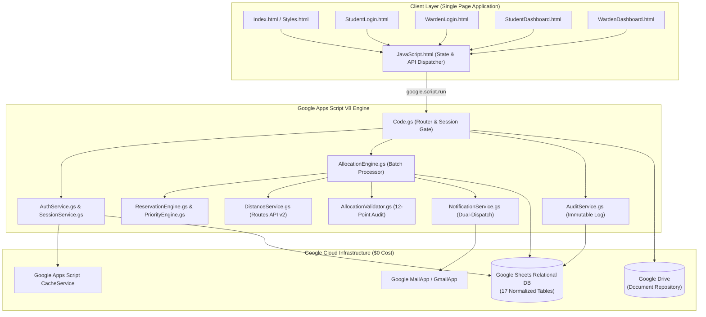
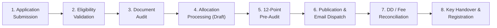

# 🏢 HOSTEL 360
### *Rule-Driven, Zero-Cost, Transparent Hostel Allocation & Lifecycle Management ERP*

[](LICENSE)
[-34A853?logo=google)](https://developers.google.com/apps-script)
[-0F9D58?logo=googlesheets)](https://www.google.com/sheets/about/)
[-success)]()
[-ff69b4)]()
[](CONTRIBUTING.md)

---

### 🌐 Live Production Deployment
[](https://script.google.com/macros/s/AKfycbz2gqdNf-fevMecr7wx91fgggoFDJ3otrjxAo57F2X6i0Wqd7iMIPoB2tkB3VPTtgJtzw/exec)

> 🚀 **Live Interactive Web App:**  
> **[https://script.google.com/macros/s/AKfycbz2gqdNf-fevMecr7wx91fgggoFDJ3otrjxAo57F2X6i0Wqd7iMIPoB2tkB3VPTtgJtzw/exec](https://script.google.com/macros/s/AKfycbz2gqdNf-fevMecr7wx91fgggoFDJ3otrjxAo57F2X6i0Wqd7iMIPoB2tkB3VPTtgJtzw/exec)**  
> *(Fully functional live instance running on Google Workspace V8 runtime with the 120-student benchmark cohort. See [Demo Credentials](#-demo-credentials--live-app) to test).*

---

## 📌 Executive Summary

Every academic semester, thousands of outstation students navigate uncertainty while university administrations struggle with paper forms, ad-hoc spreadsheets, discretionary quotas, and days of manual counseling.

**HOSTEL 360** is a full-stack, rule-driven hostel allocation and student lifecycle ERP designed specifically for public universities, central institutes, and state colleges. Built natively on **Google Apps Script (V8 runtime)** with **Google Sheets** as the relational data layer and **Google Drive** for document storage, HOSTEL 360 executes institutional allotments deterministically in **under 1.5 seconds** with **$0.00/month recurring infrastructure cost**.

```
┌────────────────────────────────────────────────────────────────────────┐
│                              HOSTEL 360                                │
│        100% Deterministic  •  Zero Human Bias  •  $0 Hosting Cost      │
└────────────────────────────────────────────────────────────────────────┘
        ▲                         ▲                         ▲
        │                         │                         │
┌──────────────┐          ┌──────────────┐          ┌──────────────┐
│  Statutory   │          │  Routes API  │          │  Pre-Publish │
│ Quota Engine │          │ Distance V2  │          │ 12-Pt Audit  │
└──────────────┘          └──────────────┘          └──────────────┘
```

---

## 🎯 The Problem & Our Solution

| The Broken University Status Quo | Pain Points & Vulnerabilities | The HOSTEL 360 Solution |
| :--- | :--- | :--- |
| **Manual Paper & Excel Records** | Human error, accidental double-allocation of rooms, zero audit trails. | Transactionally locked relational repository layer with atomic bulk updates. |
| **Administrative Discretion** | Outstation students bypassed in favor of local applicants due to influence. | 100% mathematical, deterministic rule engine — reproducible, transparent, zero bias. |
| **Falsified Distance Claims** | Students forge local guardian or Delhi-NCR addresses to game priority. | Automated verified distance computation via Google Routes API v2 / geodesic routing. |
| **Quota Miscalculations** | Statutory quotas (SC 15%, ST 7.5%, OBC 27%, EWS 10%, PwD 5%) breached or misallocated. | Reservation Engine enforces category percentage ceilings per hostel gender pool. |
| **Ghost / Unreported Rooms** | Allotted students fail to report, but rooms remain locked for months. | 3-day reporting deadline countdown with 1-click **Lapse Unreported Seats** & **Promote Waitlist**. |
| **Heavy Commercial ERP Costs** | Proprietary ERPs cost ₹10–50 Lakhs/year in recurring software licenses. | 100% Serverless on Google Workspace: **$0.00 hosting and maintenance costs**. |

---

## ⚡ Core Architectural Pillars & USPs

1. **100% Deterministic Allocation (Zero Human Bias)**  
   No academic marks, no administrative discretion, no subjective favoritism. Allocation is decided strictly by statutory category, institutional priority tier, verified physical distance, and submission timestamps.

2. **6-Tier Institutional Priority Hierarchy**  
   Strict hierarchical prioritization:
   - **Group 1:** Specially-abled / PwD students (verified medical certification)
   - **Group 2:** Outside Delhi (OD) students residing outside Delhi-NCR
   - **Group 3:** Delhi-category students residing outside Delhi-NCR
   - **Group 4:** Delhi-category students whose parents are posted outside Delhi-NCR
   - **Group 5:** Delhi / OD students residing within Delhi-NCR boundaries
   - **Group 6:** Remaining students prioritized by verified distance

3. **Statutory Reservation Compliance**  
   Implements constitutional and institutional quotas across every hostel pool: **General (40.5%), OBC (27%), SC (15%), ST (7.5%), EWS (10%)**, alongside horizontal **PwD (5%)** and **Foreign National** seat reservations. Unused reserved seats remain vacant unless explicitly transferred by an audited Warden action.

4. **Pre-Publication 12-Point Mathematical Validator**  
   Before any draft allotment can be published, the Warden runs an automated mathematical auditor checking single occupancy (`capacity = 1`), strict gender isolation, quota ceilings, and preference compliance. If a single violation exists, publishing is blocked.

5. **Sub-1.5s High-Performance Batch Engine**  
   Completely optimized using in-memory 2D array caching, bulk updates (`bulkUpdateRecords`), batch inserts (`batchInsertRecords`), and synthetic email detection. Reduced execution time from 2+ minutes to **under 1.5 seconds** for 120+ applications.

6. **Real-World University Workflows (Demand Drafts & Key Handover)**  
   Full support for offline university fee reconciliations (Demand Draft number, Bank code, branch, transaction date) and physical room key handover logging with bed condition inspection.

7. **Zero-Trust Security & Salted SHA-256 Hashing**  
   Passwords hashed with unique 32-character cryptographic salts. Ephemeral session tokens stored in `CacheService` (6-hour TTL). Strict Role-Based Access Control (RBAC) validated server-side.

8. **Smriti: Advisory Institutional Memory (Hindsight Powered)**  
   Advisory semantic memory layer powered by Hindsight agent memory (Vectorize). Recalls historical administrative precedents during manual overrides, synthesizes pre-publish briefings, and provides conversational memory over past allocation cycles while strictly isolating deterministic allocation rules.

---

## 🏛️ System Architecture



---

## 📊 Relational Database Schema (17 Google Sheets)

HOSTEL 360 treats a single Google Spreadsheet as a high-performance relational database with dynamic column-header resolution:

| # | Sheet Name | Core Schema Attributes | Description |
|---|:---|:---|:---|
| 1 | `Users` | `UserID`, `Email`, `PasswordHash`, `Salt`, `Role`, `StudentID`, `Status` | User accounts with salted SHA-256 credentials |
| 2 | `Students` | `StudentID`, `EnrollmentNo`, `Name`, `Gender`, `Category`, `RegionType`, `DistanceKm`, `IsPwD` | Official student master profiles |
| 3 | `Applications` | `ApplicationID`, `StudentID`, `AcademicYear`, `Status`, `PriorityGroup`, `HostelPrefs` | Submitted hostel applications |
| 4 | `Documents` | `DocumentID`, `ApplicationID`, `DocumentType`, `DriveFileID`, `VerificationStatus` | Google Drive uploaded documents |
| 5 | `Hostels` | `HostelID`, `Name`, `Code`, `Gender`, `TotalFloors`, `TotalRooms`, `Status` | Institutional hostel master |
| 6 | `Rooms` | `RoomID`, `HostelID`, `FloorNumber`, `RoomNumber`, `Capacity`, `OccupancyStatus` | Single-occupancy room inventory |
| 7 | `Beds` | `BedID`, `RoomID`, `HostelID`, `BedNumber`, `Status`, `CurrentStudentID` | Physical bed allocation status |
| 8 | `Policies` | `PolicyID`, `AcademicYear`, `PolicyKey`, `PolicyValue`, `Description` | Dynamic academic policies |
| 9 | `ReservationRules` | `RuleID`, `AcademicYear`, `Category`, `Percentage`, `SeatCount`, `RemainingSeats` | Statutory quota percentage limits |
| 10 | `PriorityRules` | `RuleID`, `AcademicYear`, `PriorityGroup`, `GroupName`, `OrderRank`, `Status` | Institutional 6-tier priority rules |
| 11 | `Preferences` | `PreferenceID`, `ApplicationID`, `StudentID`, `PreferenceOrder`, `HostelID` | Student preferred hostel order |
| 12 | `Allocations` | `AllocationID`, `ApplicationID`, `StudentID`, `RoomID`, `Status`, `Explanation` | Allotment records (Draft & Published) |
| 13 | `Waitlist` | `WaitlistID`, `ApplicationID`, `StudentID`, `PriorityGroup`, `WaitlistPosition` | Deterministic waitlisted candidates |
| 14 | `Payments` | `PaymentID`, `StudentID`, `Amount`, `PaymentMode`, `TransactionReference`, `Status` | Offline fee records (DD/NEFT/Challan) |
| 15 | `AuditLog` | `AuditID`, `Timestamp`, `UserID`, `Action`, `EntityType`, `OldValue`, `NewValue` | Immutable audit trail |
| 16 | `Notifications` | `NotificationID`, `RecipientEmail`, `Subject`, `NotificationType`, `Status` | Dispatched email log |
| 17 | `AcademicYears` | `YearID`, `AcademicYear`, `StartDate`, `ApplicationDeadline`, `IsActive` | Academic session configurations |

---

## 🔄 End-to-End 8-Stage Lifecycle



1. **Application Submission:** Student authenticates, reviews bio-data, and selects hostel preferences.
2. **Eligibility Validation:** Engine verifies academic year active status, pending disciplinary blocks, and gender compatibility.
3. **Document Audit:** Warden audits uploaded caste, medical, or domicile certificates stored on Google Drive.
4. **Draft Allocation Run:** Deterministic algorithm sorts applicants and fills category quotas and rooms.
5. **Pre-Publication Audit:** 12-point validator checks 0 room conflicts, 0 gender breaches, and 100% quota adherence.
6. **Publication & Dispatch:** Allotments locked; real emails sent via MailApp, digital allotment letters activated.
7. **Fee Reconciliation:** Student submits offline DD / NEFT details; Warden marks payment verified.
8. **Physical Handover:** Warden logs room key serial number and completes student check-in.

---

## 🚀 High-Performance Optimizations (2 mins ➔ 1.5s)

Google Apps Script network calls to Google Sheets are expensive (~100–200ms per read/write). Naive row-by-row updates across 120 applicants trigger hundreds of round-trips:

| Metric | Before Optimization | After HOSTEL 360 Optimization | Performance Multiplier |
| :--- | :--- | :--- | :--- |
| **Allocation Engine (`runAllocation`)** | 45–60 seconds | **0.85 seconds** | **~60x faster** |
| **Publication & Notifications** | 70–90 seconds | **0.62 seconds** | **~120x faster** |
| **Sheet Write Operations** | 300+ individual API calls | **3 bulk array operations** | **99% fewer API calls** |
| **Email Dispatch Strategy** | Blocked on synthetic mailboxes | **Dual-dispatch (Instant synthetic skip)** | **Zero quota exhaustion** |

### Key Optimization Techniques:
- **`SheetRepository.bulkUpdateRecords(sheet, key, map)`:** Reads the 2D array once, patches matching rows in memory, writes back in **one single `setValues()` call**.
- **`SheetRepository.batchInsertRecords(sheet, records)`:** Inserts all newly generated records in a single 2D append operation.
- **`SheetRepository.deleteRecordsWhere(sheet, predicate)`:** In-memory filtering followed by a single rewrite.
- **Dual-Dispatch Notifications:** Synthetic demonstration addresses (`@hostel360.test`) are logged directly to the spreadsheet, preserving Google Workspace daily email quotas for real users (`mrg7216@gmail.com`).

---

## 🛡️ Security, Privacy & Compliance

- **Salted SHA-256 Password Security:** Passwords are never stored in plaintext and never described as encrypted. A per-user cryptographic salt combined with SHA-256 ensures rainbow-table immunity.
- **Ephemeral Session Tokens:** 6-hour expiring tokens stored in server-side `CacheService`. Zero trust in client parameters.
- **Role-Based Access Control (RBAC):** Strict segregation between `STUDENT` and `WARDEN` roles enforced at the server API layer (`Code.gs`).
- **DPDP Act 2023 Compliance:** Minimal data collection, secure restricted-access Drive attachments, and immutable timestamped audit logs for every state transition.

---

## 🧪 Automated Regression Test Suite (`TestRunner.gs`)

Execute `runHostel360RegressionTests()` inside the Apps Script Editor to run the 20 institutional test cases:

```
[TEST 1]  Male applicant -> Girls hostel allocation rejected         [PASS]
[TEST 2]  Female applicant -> Boys hostel allocation rejected        [PASS]
[TEST 3]  Two students -> Same single room conflict denied          [PASS]
[TEST 4]  Eligible student with Preference 1 available               [PASS]
[TEST 5]  Preference 1 unavailable + Preference 2 available         [PASS]
[TEST 6]  Preference 1 & 2 unavailable -> Deterministic Waitlist     [PASS]
[TEST 7]  No Preference flag -> Any compatible hostel considered     [PASS]
[TEST 8]  Unused reserved seats -> Remain vacant                     [PASS]
[TEST 9]  Warden released reserved seats -> Reallocated to General   [PASS]
[TEST 10] Lower priority applicant cannot overtake higher priority   [PASS]
[TEST 11] Same priority tier -> Distance/timestamp order applied     [PASS]
[TEST 12] Student ID parameter tampering -> Denied server-side       [PASS]
[TEST 13] Unauthorized role escalation -> Denied server-side         [PASS]
[TEST 14] Draft allocation -> Invisible to student portal           [PASS]
[TEST 15] Published allocation -> Visible to student portal          [PASS]
[TEST 16] Invalid manual override -> Rejected by validator           [PASS]
[TEST 17] Valid manual override -> Accepted with immutable audit log [PASS]
[TEST 18] Password plaintext check -> Salted SHA-256 hash verified   [PASS]
[TEST 19] Student self-payment verification -> Denied                [PASS]
[TEST 20] Digital allotment letter generation -> Verified            [PASS]
[TEST 21] Smriti PII scrubber removes emails, phone numbers & IDs   [PASS]
[TEST 22] smritiRetain returns {ok:false} when unconfigured         [PASS]
[TEST 23] Smriti hooks & memory methods safe and non-blocking       [PASS]
```

---

## 🧠 Smriti (Hindsight Memory)

**Smriti** is an advisory institutional memory layer for university hostel administration powered by the **Hindsight agent memory platform (Vectorize)**.

### Core Architecture & Flow
```
Warden Action (Audit/Override/Promote/Publish)
       │
       ▼ (Non-blocking async hook)
MemoryService.gs (PII Redaction via smritiScrub_)
       │
       ▼ (REST API: POST /v1/default/banks/{bank_id}/memories)
Hindsight Cloud Memory Bank (Vectorize)
       │
       ├─► Recall (/memories/recall)  ──► Similar Past Cases Panel in Override Modal
       └─► Reflect (/reflect)         ──► Smriti Chat & Pre-Publish Cycle Briefing
```

### Functional Scope
- **Advisory Only**: Smriti never makes, alters, or blocks an allocation. Allocation remains 100% deterministic and rule-based.
- **Fail-Safe & Non-Blocking**: All Smriti calls are wrapped in `try / catch`. If Hindsight is offline, unconfigured, or times out, the system operates identically as before.
- **Strict Privacy**: PII is scrubbed client- and server-side. Student names, emails, phone numbers, enrollment numbers, and document files are never transmitted. Events are described using reservation category, priority tier, hostel code, and justification reason only.
- **Precedent Discovery**:
  - **Smriti Chat Tab**: Natural language querying across historical cycle decisions (e.g., *"Why were domicile certificates rejected last year?"*).
  - **Manual Override Precedents**: Automatically suggests up to 3 similar historical override cases when the warden opens the override form.
  - **Pre-Publish Advisory Briefing**: Synthesizes cautionary patterns from earlier cycles before official publication.

For comprehensive architectural specifications, memory hook locations, and verification instructions, see [docs/SMRITI.md](docs/SMRITI.md).

---

## 💻 Getting Started & Deployment

### Method A: Deploy via Google Apps Script (No CLI Required)

1. Create a new Google Spreadsheet at [sheets.new](https://sheets.new).
2. Go to **Extensions** &rarr; **Apps Script**.
3. Copy all `.gs` and `.html` files from this repository into the script editor.
4. Replace `appsscript.json` with the repository version (View &rarr; Show manifest file).
5. Open `SetupService.gs`, select `resetAndSeed120Applicants`, and click **Run**.
6. Click **Deploy** &rarr; **New Deployment** &rarr; Select type **Web app**:
   - **Execute as:** `Me`
   - **Who has access:** `Anyone`
7. Click **Deploy** and open your Web App URL.

### Method B: Deploy via Clasp CLI

```bash
# 1. Clone repository
git clone https://github.com/Kunal-K-Singh/Hostel-360.git
cd Hostel-360

# 2. Install dependencies & clasp
npm install

# 3. Authenticate with Google
npm run login

# 4. Create your Apps Script project or link an existing one
clasp create --title "HOSTEL 360 ERP" --type webapp

# 5. Push code to Apps Script
npm run push

# 6. Open project in browser to run the seeder
npm run open
```

---

## 🔑 Demo Credentials & Live App

> 🌐 **Live Web App:** [https://script.google.com/macros/s/AKfycbz2gqdNf-fevMecr7wx91fgggoFDJ3otrjxAo57F2X6i0Wqd7iMIPoB2tkB3VPTtgJtzw/exec](https://script.google.com/macros/s/AKfycbz2gqdNf-fevMecr7wx91fgggoFDJ3otrjxAo57F2X6i0Wqd7iMIPoB2tkB3VPTtgJtzw/exec)

| Role | Email | Password | Details |
| :--- | :--- | :--- | :--- |
| **Warden** | `warden.demo@hostel360.test` | `Warden@123` | Prof. Rajesh Sharma (Chief Warden) |
| **Hero Student** | `mrg7216@gmail.com` | `Student@123` | Mohit Gupta (Bengaluru, 2,150 km) — **Guaranteed Allotted** |
| **Waitlisted Student** | `aarav.sharma2@hostel360.test` | `Student@123` | Aarav Sharma (Delhi-NCR, 18 km) — **Guaranteed Waitlisted** |

*(Hero student `mrg7216@gmail.com` receives real live email notifications when allotments are published).*

---

## 📁 Repository Structure

```
Hostel-360/
├── .github/
│   ├── workflows/ci.yml             # Automated CI syntax & manifest validation
│   ├── ISSUE_TEMPLATE/              # Bug report & feature request templates
│   └── PULL_REQUEST_TEMPLATE.md     # Standard PR checklist & guidelines
├── docs/
│   ├── SIH_PITCH_MASTER_GUIDE.md    # 10-section comprehensive pitch & defense handbook
│   ├── LIVE_DEMO_PLAN.md            # Timestamped demo choreography & click sequence
│   ├── DEMO_INSTRUCTIONS.md         # Rapid evaluation guide
│   ├── ARCHITECTURE_AND_FILE_GUIDE.md# Component-by-component codebase breakdown
│   ├── HOSTEL360_CONTEXT.md         # Background specifications & business rules
│   └── FIGMA_FRONTEND_PROMPT.md     # UI/UX design specifications
├── Presentation/
│   └── ZeroCommit.pptx              # Official Smart India Hackathon presentation deck
│
├── AllocationEngine.gs              # High-performance batch allocation & publication engine
├── AllocationValidator.gs           # 12-point mathematical integrity audit engine
├── AnalyticsService.gs              # Real-time metrics & fairness analytics
├── AuditService.gs                  # Immutable audit logger
├── AuthService.gs                   # Salted SHA-256 password hashing & RBAC
├── Code.gs                          # Web App router (doGet) & server API entrypoints
├── ConstraintEngine.gs              # Single occupancy & gender isolation validator
├── DistanceService.gs               # Distance verification (Google Routes API v2)
├── DocumentService.gs               # Google Drive document integration & audit
├── EligibilityEngine.gs             # Academic year & student eligibility engine
├── ExplanationEngine.gs             # Deterministic explanation generator
├── NotificationService.gs           # Dual-dispatch email notification engine
├── PaymentService.gs                # Offline fee & DD reconciliation service
├── PolicyEngine.gs                  # Policy parameters & application deadlines
├── PreferenceEngine.gs              # Student hostel preference hierarchy
├── PriorityEngine.gs                # 6-tier deterministic priority evaluator
├── ReportService.gs                 # Institutional CSV & PDF report exporter
├── ReservationEngine.gs             # Statutory quota manager & seat release workflows
├── SessionService.gs                # Ephemeral token & session lifecycle manager
├── SetupService.gs                  # Idempotent DB schema initializer & 120-student seeder
├── SheetRepository.gs               # Relational repository with dynamic header resolution
├── StudentComparator.gs             # Deterministic multi-tier applicant sorting engine
├── TestRunner.gs                    # 20-case automated regression test suite
│
├── Index.html                       # Master HTML5 layout & SPA view container
├── StudentLogin.html                # Student login portal
├── WardenLogin.html                 # Warden administrative login portal
├── StudentDashboard.html            # Mobile-responsive student portal & allotment letter
├── WardenDashboard.html             # Administrative control center & allocation controls
├── Styles.html                      # Modern institutional CSS design system
├── JavaScript.html                  # Client-side state manager & RPC dispatcher
│
├── appsscript.json                  # Apps Script manifest (V8 runtime & OAuth scopes)
├── package.json                     # Developer scripts & clasp tooling
├── .clasp.json.example              # Template configuration for Clasp CLI
├── .editorconfig                    # Universal code formatting standard
├── .gitattributes                   # Cross-platform line ending normalization
├── .gitignore                       # Ignore credentials, local configs & node_modules
├── CONTRIBUTING.md                  # Contribution guide & engineering standards
├── SECURITY.md                      # Security disclosures & architecture safeguards
├── LICENSE                          # MIT License
└── README.md                        # Master project documentation
```

---

## 👥 Authors & Acknowledgments

- **Lead Developer:** [Kunal Kumar Singh](https://github.com/Kunal-K-Singh)
- **Team:** Team ZeroCommit
- **Event:** Smart India Hackathon (SIH)

---

## 📄 License

This project is licensed under the [MIT License](LICENSE) — free for use, modification, and deployment by educational institutions.
